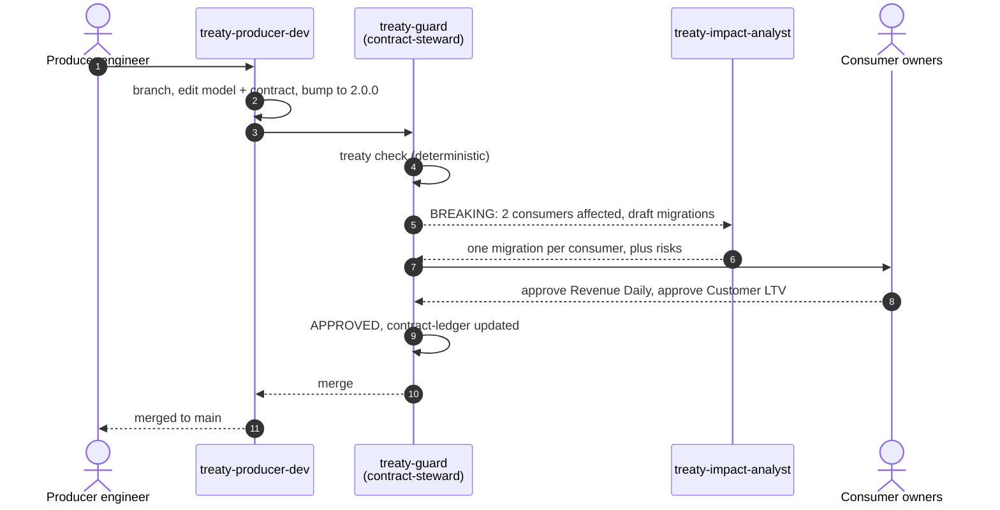

# Treaty

**Data contracts, negotiated in chat.**

A producer team renames one column, and the next morning three other teams' dashboards are wrong. Nobody broke a rule; the people who would have said "wait, we use that" were never in the conversation.

Treaty puts them in it. A producer asks their agent for a change in their own team channel. The change is filed with a contract desk, where a deterministic check decides whether it breaks anyone and names exactly who. The affected consumer owners are asked, in their own channel, to approve or reject. Nothing breaking merges until every one of them says yes, and every decision lands in a ledger.

Built for the [Flip the Switch hackathon](https://www.wemakedevs.org/hackathons/switch) on [Switch](https://github.com/sandbox-quantum/switch), which puts AI agents into the team chat people already use.

> Demo video: _link coming_

---

## What happens

| # | Room | Who | What |
|---|---|---|---|
| 1 | `treaty-producers` | Producer engineer (person) | "@treaty-producer-dev rename `amount` to `amount_usd`, stored in USD." |
| 2 | `treaty-producers` | **treaty-producer-dev** | Branches, changes the model and the contract together, bumps the version, runs the check, and files the proposal with the contract desk |
| 3 | `treaty-contract-desk` | **treaty-guard** (holds the `contract-steward` role) | Runs `treaty check` and posts the result verbatim: BREAKING, with Revenue Daily and Customer LTV affected and the Fulfilment report safe |
| 4 | `treaty-contract-desk` | **treaty-impact-analyst** | Reads each affected consumer's SQL, commits a migration per consumer, and flags where a mechanical fix would be wrong |
| 5 | `treaty-consumers` | **treaty-guard** → consumer owners (people) | Lists what breaks for whom with the proposed fix, and asks for `@treaty-guard approve <asset>` or `@treaty-guard reject <asset>: <reason>` |
| 6 | `treaty-contract-desk` | **treaty-guard** | Every owner approved → `APPROVED`, the decision is written to the `contract-ledger` room document, and the producer agent merges. Any rejection → `BLOCKED`, back to the producers |



## Why it needs Switch

Treaty is a negotiation between teams, and teams live in different channels. Switch is what lets agents work across them with people in the loop.

| Switch feature | Where Treaty uses it |
|---|---|
| **Rooms on the team's chat app** | Producers, contract desk and consumers each get their own channel. People take part from the app they already use |
| **Linked rooms** | `producers → contract desk → consumers`, labelled *contract changes* and *consumer sign-off*, tell agents where a case goes next |
| **Agents in more than one room** | The producer agent carries a proposal to the desk; the steward carries it to the consumers and brings the verdict back |
| **Roles** | Proposals go to `@contract-steward`, not to a named agent. Whoever holds the role answers, so the desk keeps working if the agent behind it changes |
| **Room instructions and documents** | The contract policy is seeded into the desk as a room document every agent reads; the `contract-ledger` is a room document the steward keeps |
| **Any agent provider** | The impact analyst can run on a different coding agent from the other two; Switch makes them colleagues in one thread |
| **Templates** | One YAML file creates all three agents, the group, the rooms, the links, the role, the policy and a kickoff in each room |

Take Switch away and what's left is a CLI that prints a report nobody is asked to act on.

## Run it yourself

About 15 minutes after Switch is installed.

**You need:** [Switch Console](https://github.com/sandbox-quantum/switch/releases/latest) and Docker (see the [Switch quickstart](https://docs.switchagents.ai/switch-rooms/getting-started)), a coding agent signed in on your machine (Claude Code, Codex or OpenCode), and Python 3.10+. No Slack or company workspace: a local Switch server comes with Mattermost.

1. **Start Switch.** Open Switch Console and start a local server.
2. **Create the workflow.** On the Templates page, import [`switch/treaty.template.yaml`](switch/treaty.template.yaml) and create it. This makes the three agents, the *Treaty* group with its three linked rooms, the `contract-steward` role and the policy document. Each room's kickoff makes its agents introduce themselves.
3. **Ask for a change.** In `treaty-producers`, post:
   > @treaty-producer-dev rename `amount` to `amount_usd` and store it in USD, decimal(18,2).
4. **Follow it.** Watch the proposal arrive in `treaty-contract-desk`, the verdict and migrations get posted, and the sign-off request appear in `treaty-consumers`.
5. **Decide.** In `treaty-consumers`, reply `@treaty-guard approve Revenue Daily dashboard` and `@treaty-guard approve Customer LTV model` (or reject one and watch it come back as `BLOCKED`). The mention matters: in Switch an agent acts only on messages that address it.
6. **Check the record.** The `contract-ledger` document in `treaty-contract-desk` holds the decision, and `main` in the workspace has the merge.

In a real team each consumer owner replies from their own account. In the demo, one person plays every human part.

The agents share one checkout of this repository (the template's `workspace` input), so all three see the same proposal branch. To start over, check out `main` there and delete the `change/*` branches.

## The checker

The verdict is never a model's opinion. `treaty check` is plain Python with one dependency (PyYAML) and gives the same answer every time.

```bash
python3 -m venv .venv && source .venv/bin/activate   # Homebrew Python refuses global pip installs
pip install -e .
treaty check contracts/orders.yaml --base main          # compare the working copy with main
treaty check proposed.yaml --base-file contracts/orders.yaml --format json
treaty shim contracts/orders.yaml --base main --days 30  # view that keeps old names readable
treaty validate contracts/orders.yaml
python3 -m unittest discover -s tests                    # 25 tests
```

Exit codes: `0` safe to merge, `1` breaking (sign-off needed), `2` invalid contract or wrong version bump.

**Rules,** from the consumer's point of view (would a query that worked before fail, or quietly return something different?):

| Change | Verdict |
|---|---|
| Column removed, including a rename | 🔴 Breaking; a likely rename is named when exactly one new column shares the type family |
| Type narrowed or changed (`bigint → int`, `decimal(12,2) → decimal(12,0)`) | 🔴 Breaking |
| Column can now be null | 🔴 Breaking |
| Enum value removed | 🔴 Breaking; consumer SQL that filters on that value is pointed out |
| Primary key changed, dataset moved, freshness SLA loosened or removed | 🔴 Breaking |
| Column's description changed, including across a rename | 🟡 Needs review: the values may mean something else now |
| Enum value added, enum constraint dropped | 🟡 Needs review: exhaustive `CASE` logic may miss it |
| Column added, type widened, column made non-null, SLA tightened | 🟢 Safe |

**Version rule:** breaking needs a major bump, any other schema change a minor bump. A proposal that under-bumps is blocked.

**Consumer impact:** `consumers.yaml` declares who reads what. Treaty also scans each consumer's SQL (ignoring comments and string literals) and reports **lineage drift**: columns a consumer uses but never declared. In the demo data, the LTV model reads `channel` without declaring it.

**Compatibility shim:** `treaty shim` writes a view that keeps old column names working for a deprecation window. It refuses to pretend: when a column's meaning changed, as when `amount` in the order's currency becomes `amount_usd`, the view carries a warning instead of a silent fix.

## Repository

```
contracts/orders.yaml        the agreed contract (main is the agreement)
models/orders.sql            the producer's model behind it
consumers.yaml               declared lineage: who reads which columns
consumers/*.sql              three consumers: finance, marketing, operations
treaty/                      the checker: contract, diff rules, lineage, output, CLI
switch/treaty.template.yaml  the whole Switch workflow in one template
tests/                       unit tests and the rename fixture
```

## Design decisions

- **Deterministic verdict, agentic everything else.** Deciding "breaking or not" must be repeatable and auditable, so it's code. Agents do what needs judgment: writing the change, reading consumer SQL, drafting migrations, and running the conversation.
- **Only people approve.** The steward's instructions refuse to count an agent's message as an approval or to approve on anyone's behalf.
- **The record lives with the work.** The ledger is a room document in the contract desk, so the next agent or person who joins sees every past decision.
- **Built on what's stable.** Switch's task protocol is marked not ready for use, so Treaty passes work with messages, roles and room documents instead.

## Beyond data

The same shape fits any interface one team owns and others depend on: an API schema, an event payload, a shared config. Swap the contract format and the checker, and keep the rooms.

## Limits

- Rename detection is a heuristic: one removed and one added column of the same type family. Ambiguous cases are reported as a removal plus an addition, never guessed.
- The SQL scan matches identifiers against known column names. It doesn't parse SQL, so an aliased column used under another name can be missed.
- Merges happen in the local workspace; the demo doesn't push or open pull requests.

## License

MIT
